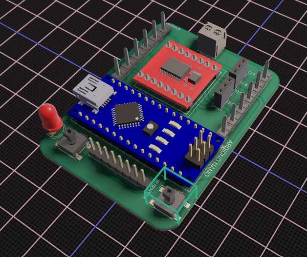
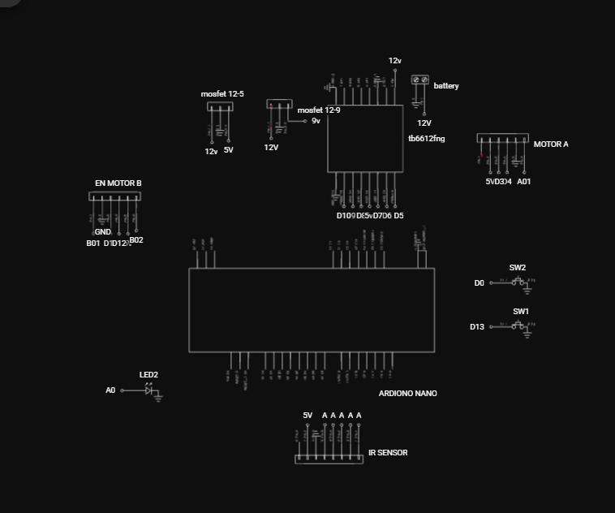
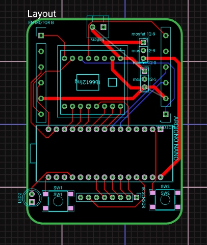

# Line-Follower & Maze-Solver Robot PCB

**A plug-in carrier board for competition line-follower and maze-solving robots: Arduino Nano, TB6612FNG dual motor driver, IR sensor array input and start / calibrate buttons on one clean PCB.**

---

## Why

Breadboard robots fall apart on the track. This board replaces the jumper-wire nest with a single PCB: drop in an Arduino Nano and a TB6612FNG module, plug in the IR array and motors, and you're racing.

## Features

- **Arduino Nano** socket
- **TB6612FNG** dual motor driver module socket (two DC motors, PWM speed + direction)
- **IR sensor array** connector (5 V, GND + 5 analog inputs)
- Motor A / Motor B output headers
- **Battery input** with screw terminal, plus 12 V → 9 V and 12 V → 5 V regulator module headers
- **SW1 / SW2** push buttons (start, mode select or sensor calibration)
- Status LED

## Design

<table>
<tr>
<td width="50%"> <b>Schematic</b></td>
<td width="50%"> <b>PCB layout</b></td>
</tr>
</table>

## Wiring

Full connection guide, battery recommendations, a pre-power checklist and common fixes: **[docs/wiring_notes.md](docs/wiring_notes.md)**

## Roadmap

- [x] Schematic + PCB layout
- [ ] Gerbers committed to the repo
- [ ] Example line-following + maze-solving (LSRB) Arduino sketch
- [ ] Photos / video of the bot on a track

## License

[MIT](LICENSE) © Prateek Sarkar

**Building a bot for a robotics competition? Star ⭐ the repo and share your build.**

